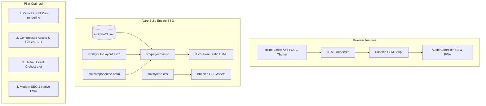

# 🧭 Blueprint & Rundown Optimasi Lanjutan — TKJ XI-9 Astro
**Status Proyek:** Porting & Modernisasi Astro v6 · **Tanggal Audit:** Oktober 2026  
**Fokus Utama:** Perbaikan Bug Fungsional, Astro Native SSG, Optimasi Aset & Web Performance, PWA Offline, dan SEO Modern.

---

## 📌 Executive Summary & Temuan Audit Menyeluruh

Setelah dilakukan penelusuran arsitektur, kode komponen, skrip client-side, gaya CSS, serta folder aset di `d:\ALFREDO\xi9-astro-main`, berikut ringkasan temuan utama:

```
┌────────────────────────────────────────────────────────────────────────┐
│                          RINGKASAN STATUS KESEHATAN SISTEM             │
├────────────────────────┬────────┬──────────────────────────────────────┤
│ Aspek                  │ Status │ Catatan Kritis                       │
├────────────────────────┼────────┼──────────────────────────────────────┤
│ 1. Navigasi Mobile     │ 🔴 CRITICAL│ Hamburger menu macet (ID CSS vs JS)  │
│ 2. Logika Event & DOM  │ 🟡 WARNING │ Duplikasi listener (Jam, Offline)    │
│ 3. SSG Pre-rendering   │ 🟡 SUB-OPT │ Keahlian & TKJ di-render via JS DOM  │
│ 4. Asset Footprint     │ 🔴 HEAVY   │ Total 18.1MB; Logo SVG = 1.92MB      │
│ 5. PWA & Service Worker│ 🔴 BROKEN  │ Path usang /pokok/ & belum diregister│
│ 6. SEO & Meta Tags     │ 🟡 BASIC   │ Belum ada OG tags, Canonical, JSON-LD│
│ 7. Theme Switching     │ 🟡 FOUC    │ Potensi kedipan tema saat cold load  │
│ 8. Dead Code           │ 🟢 CLEANUP │ `pengaturan.js` (835 baris) usang    │
└────────────────────────┴────────┴──────────────────────────────────────┘
```

---

## 🔍 Bab 1: Detail Temuan Audit Menyeluruh

### 1. Bug Kritis Navigasi (Hamburger Menu Tidak Berfungsi)
* **Lokasi:** `src/components/HamburgerMenu.astro` vs `src/scripts/utama.js` vs `src/styles/tata-letak.css`.
* **Masalah:**
  - Komponen menggunakan ID `#menu-hamburger` dengan kelas anak `.tutup-menu-hamburger`.
  - Skrip `utama.js` mencari `#menu-navigasi` dan `#menu-overlay`. Karena tidak ditemukan, fungsi keluar `return` tanpa melakukan apapun.
  - Gaya CSS di `tata-letak.css` menunggu atribut `aria-hidden="false"` dan kelas `body.menu-terbuka`.
* **Dampak:** Pengguna di perangkat seluler (layar < 768px) tidak dapat membuka menu navigasi utama sama sekali.

### 2. Duplikasi Script & Event Listener
* **Global Clock:**
  - `GlobalClock.astro` memiliki inline `<script>` mandiri dengan listener drag pointer dan interval 1 detik.
  - `src/scripts/alat.js` (`mulaiJam()`) yang dipanggil di `utama.js` juga menjalankan interval 1 detik dan listener drag mouse/touch.
  - Hasil: Dua interval berjalan paralel dan terjadi perebutan manipulasi posisi DOM.
* **Offline Badge:**
  - `OfflineBadge.astro` memiliki inline `<script>` untuk event `online`/`offline`.
  - `utama.js` (`initNetworkStatus()`) juga memasang listener yang sama persis.
* **Double Import `utama.js`:**
  - `Layout.astro` sudah memuat `utama.js` untuk seluruh halaman.
  - `keahlian.astro` dan `tkj.astro` memuat ulang `import '../scripts/utama.js'`, berisiko menduplikasi handler event global.

### 3. Degradasi Performa & Hilangnya Manfaat SSG Astro
* **Halaman Keahlian (`src/pages/keahlian.astro`):**
  - Hanya merender container kosong `<div id="skills-list"></div>`. Seluruh kartu keahlian dibangun di client-side melalui manipulasi DOM `document.createElement()` di `keahlian.js`.
  - *Efek:* Robot perayap search engine (Googlebot) melihat halaman kosong, nilai LCP/FCP tertunda, dan terjadi CLS (layout shift) saat JS selesai dieksekusi.
* **Halaman TKJ (`src/pages/tkj.astro`):**
  - Elemen Mata Pelajaran, Alur Kurikulum, dan Prospek Karir dirender via `.innerHTML` di client-side melalui `tkj.js`.
  - *Efek:* Seharusnya seluruh konten edukasi ini di-prerender langsung secara statis oleh Astro.

### 4. Overweight Assets (Total 18.1 MB)
* **`public/assets/logo/logo-utama.svg` (1.92 MB):**
  - Berisi data base64 gambar raster PNG ukuran 1400x1400 piksel di dalam tag SVG.
  - Logo ini dimuat di bilah navigasi atas di **setiap halaman website**. Mengunduh 1.9MB hanya untuk logo header 40px sangat membebani kuota dan memperlambat render.
* **Media Galeri (`public/assets/kenangan/`):**
  - `kenangan11.webp` (2.15 MB), `kenangan13.webp` (1.08 MB), `meme.png` (885 KB). Belum dikompresi sesuai standar web modern (target < 150-250 KB per gambar).
* **Audio Latar (`videoplayback.weba` 5.41 MB):**
  - Dimuat via iframe hidden di seluruh halaman. Perlu mekanisme on-demand / lazy loading audio stream agar tidak mengonsumsi bandwidth saat mode audio non-aktif.

### 5. Service Worker PWA Patah & Tidak Terdaftar
* `public/sw.js` masih berisi path precache lama sebelum migrasi:
  ```javascript
  './pokok/gaya/dasar.css',
  './pokok/gaya/animasi.css',
  './pokok/gaya/tata-letak.css',
  './pokok/skrip/utama.js'
  ```
  Path tersebut sudah tidak ada karena Astro membundel CSS/JS ke dalam `/_astro/`.
* `navigator.serviceWorker.register('/sw.js')` tidak pernah dipanggil di file manapun.
* `public/others/manifest.json` berada di sub-folder yang menyebabkan scope salah, serta mengarah ke `./halaman/anggota/index.html` (rute Astro yang benar: `/anggota`).

### 6. File 404 & Offline Masih Monolitik
* `public/404.html` dan `public/offline.html` masih menggunakan script inline untuk memanggil `./pokok/gaya/dasar.css`.
* Seharusnya dipindahkan ke `src/pages/404.astro` dan `src/pages/offline.astro` sehingga otomatis mewarisi `Layout.astro`, gaya desain, dan komponen standar.

### 7. Flash of Unstyled Theme (FOUC/FOIT)
* `Layout.astro` menetapkan `data-theme="dark"` secara statis di tag `<html>`.
* `tema.js` memiliki `defaultTheme = "light"` dan baru berjalan di event `DOMContentLoaded`.
* Jika pengguna sebelumnya memilih tema light atau blue, browser akan menampilkan warna gelap terlebih dahulu sebelum berganti tema seketika (flicker).

### 8. Fitur Menggantung & Dead Code
* Tombol `#replay-intro-tombol` di `Footer.astro` tidak memiliki event listener apa pun.
* File `src/scripts/pengaturan.js` (835 baris) adalah artefak lama yang tidak digunakan lagi karena seluruh sistem membaca data dari `src/data/G.json`.

---

## 🗺️ Bab 2: Blueprint Arsitektur Target (To-Be Architecture)



---

## 🚀 Bab 3: Rundown Eksekusi Bertahap (Action Plan)

### Fase 1: Perbaikan Bug Fungsional & Harmonisasi Komponen (Quick Wins)
> **Tujuan:** Menghilangkan error, memulihkan menu navigasi mobile, dan membersihkan duplikasi listener.

1. **Sinkronisasi Hamburger Menu:**
   - Sesuaikan `src/scripts/utama.js` agar membaca elemen `#menu-hamburger`, tombol `.tutup-menu-hamburger`, dan tombol `#hamburger-tombol`.
   - Toggle atribut `aria-hidden="false"` pada `#menu-hamburger` dan kelas `menu-terbuka` pada `document.body` saat dibuka/ditutup.
   - Aktifkan trap fokus menggunakan `enableFocusTrap(menuPanel)`.

2. **Konsolidasi Global Clock & Offline Badge:**
   - Hapus script duplikat di `src/scripts/alat.js` (`mulaiJam()` dan `initNetworkStatus()`), serahkan tanggung jawab sepenuhnya kepada komponen `GlobalClock.astro` dan `OfflineBadge.astro`.
   - Bersihkan pemanggilan di `src/scripts/utama.js`.

3. **Aktifkan Replay Intro:**
   - Pasang event handler untuk `#replay-intro-tombol` di `Footer.astro` / `utama.js`:
     ```javascript
     document.getElementById("replay-intro-tombol")?.addEventListener("click", () => {
       sessionStorage.removeItem("tkj-intro-done");
       window.location.href = "/";
     });
     ```

4. **Eliminasi Dead Code:**
   - Hapus atau arsipkan `src/scripts/pengaturan.js` agar tidak membingungkan tim dan sistem perayap repo.
   - Hapus impor ganda `import '../scripts/utama.js';` di `keahlian.astro` dan `tkj.astro`.

---

### Fase 2: Maksimalisasi Astro SSG Pre-rendering & Anti-FOUC
> **Tujuan:** Menjadikan seluruh konten langsung tersedia di HTML murni tanpa bergantung pada eksekusi JavaScript.

1. **Migrasi Halaman Keahlian (`keahlian.astro`):**
   - Lakukan iterasi `G.skills.map(...)` langsung di file `.astro` untuk merender seluruh kartu keahlian secara server-side.
   - Skrip `keahlian.js` cukup bertanggung jawab memicu animasi lebar bar (`width`) dan counter persentase saat kartu masuk viewport via `IntersectionObserver`.

2. **Migrasi Halaman TKJ (`tkj.astro`):**
   - Render langsung array `G.tkj.mapel`, `G.tkj.karir`, dan `G.tkj.kurikulum` menggunakan sintaks template Astro.
   - Skrip `tkj.js` difokuskan murni untuk fitur interaktif: Subnet Calculator dan Ping Simulator.

3. **Pencegahan Kedipan Tema (Anti-FOUC):**
   - Sisipkan skrip inline non-blocking di `<head>` pada `Layout.astro`:
     ```html
     <script is:inline>
       const savedTheme = localStorage.getItem('tkj-theme') || 'dark';
       document.documentElement.setAttribute('data-theme', savedTheme);
     </script>
     ```

4. **Konversi Halaman 404 & Offline ke Astro:**
   - Buat `src/pages/404.astro` yang mengadopsi `Layout.astro`, menampilkan animasi terminal retro 404 dan opsi kembali ke beranda.
   - Buat `src/pages/offline.astro` dengan styling konsisten.

---

### Fase 3: Optimasi Aset & Media (Bandwidth Buster)
> **Tujuan:** Memangkas ukuran transfer aset dari 18.1 MB menjadi di bawah 4 MB.

1. **Restrukturisasi Logo Utama (`logo-utama.svg`):**
   - Ekstrak base64 PNG yang ada di dalam SVG.
   - Konversi gambar logo ke format WebP mini (~25-40 KB) atau bersihkan SVG menjadi vektor murni tanpa embed raster base64 1400px.
   - *Estimasi Penghematan:* **-1.88 MB** pada setiap pemuatan awal halaman!

2. **Kompresi Gambar Galeri & Foto Kenangan:**
   - Gunakan kompresi WebP kualitas 80% dengan resize dimensi maksimal 1280px (untuk galeri) dan 400px (untuk avatar profil).
   - `kenangan11.webp` (2.15 MB) ➔ target < 200 KB.
   - `kenangan13.webp` (1.08 MB) ➔ target < 180 KB.
   - `meme.png` (885 KB) ➔ konversi ke WebP < 100 KB.

3. **Strategi Streaming Audio Latar:**
   - Ubah iframe audio player agar tidak langsung melakukan buffer audio besar sebelum pengguna berinteraksi atau menyalakan toggle audio.

---

### Fase 4: PWA Offline, Service Worker & Konfigurasi Astro
> **Tujuan:** Menyediakan kapabilitas offline yang andal dan integrasi build Astro yang lengkap.

1. **Konfigurasi `astro.config.mjs`:**
   ```javascript
   import { defineConfig } from 'astro/config';
   import sitemap from '@astrojs/sitemap';

   export default defineConfig({
     site: 'https://tkj-xi9.mubela.sch.id', // domain riil
     compressHTML: true,
     integrations: [sitemap()],
   });
   ```

2. **Modernisasi `sw.js`:**
   - Pindahkan Service Worker ke strategi runtime caching modern (Cache-first untuk assets statis, Network-first dengan fallback ke offline page untuk navigasi dokumen).
   - Bersihkan referensi path lama `/pokok/gaya/`.
   - Daftarkan Service Worker secara resmi di `Layout.astro`:
     ```html
     <script is:inline>
       if ('serviceWorker' in navigator && !window.location.host.startsWith('localhost')) {
         window.addEventListener('load', () => {
           navigator.serviceWorker.register('/sw.js').catch(console.error);
         });
       }
     </script>
     ```

3. **Perapihan Root Manifest & Robots:**
   - Pindahkan `public/others/manifest.json` ke `public/manifest.json` dan perbaiki seluruh link URL pintasan (`/anggota`, `/galeri`).
   - Pindahkan `public/others/robots.txt` ke `public/robots.txt` di root web server.

---

### Fase 5: SEO Modern, Open Graph & Aksesibilitas (A11y)
> **Tujuan:** Menjamin indeksasi sempurna di Google dan tampilan kartu sosial media yang profesional.

1. **Meta Tag Sosial & Canonical:**
   - Tambahkan tag berikut di `Layout.astro`:
     - `<link rel="canonical" href={Astro.url} />`
     - `<meta property="og:title" content={title} />`
     - `<meta property="og:description" content={description} />`
     - `<meta property="og:image" content={G.ogImage} />`
     - `<meta property="og:url" content={Astro.url} />`
     - `<meta name="twitter:card" content="summary_large_image" />`

2. **Schema.org Structured Data (JSON-LD):**
   - Sisipkan data terstruktur tipe `EducationalOrganization` dan `BreadcrumbList` agar Google Search menampilkan rich snippet kelas.

3. **Penyempurnaan Aksesibilitas (A11y):**
   - Pastikan slider anggota tidak menggunakan event wheel dengan `{ passive: false }` yang menahan thread scroll browser.
   - Tambahkan fallback visual dan teks jika font Awesome belum terunduh saat mode offline.

---

## 📋 Check-list Eksekusi Prioritas

- [ ] **Prioritas 1 (Kritis):** Perbaiki logic hamburger menu di `utama.js` agar sesuai dengan markup di `HamburgerMenu.astro` & CSS.
- [ ] **Prioritas 1 (Kritis):** Hapus duplikasi event handler di `GlobalClock.astro`, `OfflineBadge.astro`, dan `alat.js`.
- [ ] **Prioritas 2 (Performa):** Optimasi `logo-utama.svg` (hilangkan base64 1.9MB, ganti dengan WebP/SVG murni).
- [ ] **Prioritas 2 (Arsitektur):** Konversi `keahlian.astro` dan `tkj.astro` ke Native Astro SSG.
- [ ] **Prioritas 2 (UX):** Pasang script anti-FOUC theme inline di `<head>`.
- [ ] **Prioritas 3 (PWA/Offline):** Perbaiki `sw.js`, `manifest.json`, dan register service worker di `Layout.astro`.
- [ ] **Prioritas 3 (Halaman):** Migrasi `404.html` dan `offline.html` menjadi `src/pages/404.astro` dan `src/pages/offline.astro`.
- [ ] **Prioritas 4 (SEO):** Tambahkan OpenGraph, Canonical, dan integrasi sitemap di `astro.config.mjs`.
- [ ] **Prioritas 4 (Pembersihan):** Hapus `src/scripts/pengaturan.js` dan aktifkan tombol `#replay-intro-tombol`.

---
*Blueprint ini siap dijadikan panduan teknis langkah-demi-langkah untuk tahap eksekusi refactor berikutnya.*
